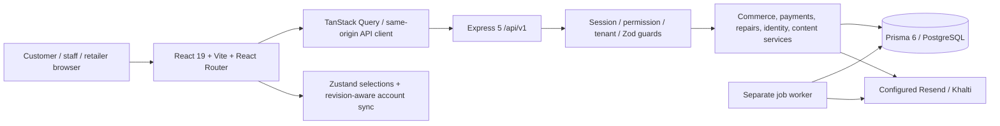

# iPhoneBooking architecture

Current implementation, reviewed 6 October 2026. Start with the [repository audit](docs/repository-audit-v2.md). The existing stack and business records are preserved; this is an incremental extension of the application, with launch boundaries in [DEPLOYMENT.md](DEPLOYMENT.md).

## Source responsibilities

| Path                              | Responsibility                                                                               |
| --------------------------------- | -------------------------------------------------------------------------------------------- |
| `apps/web/src/app`                | Routes, lazy page loading, crash recovery and locale context                                 |
| `apps/web/src/components`         | Shared shell, buttons, dialogs, product cards and visuals                                    |
| `apps/web/src/features`           | Homepage sections, category composition, search, payment panel and verified reviews          |
| `apps/web/src/pages`              | Customer journeys, account pages, retailer workspace and permission-gated administration     |
| `apps/web/src/services`, `stores` | API contracts, requests and persisted selections                                             |
| `apps/web/src/styles`             | Semantic tokens, self-hosted fonts and scoped component styles                               |
| `apps/api/server/routes`          | HTTP validation, identity/scope checks, domain invocation and response projection            |
| `apps/api/server/services`        | Authoritative quotes, payment evidence, jobs, valuation, procurement, device history and SEO |
| `apps/api/prisma`                 | Relational source of truth and reviewed additive migrations                                  |
| `tests`                           | Isolated database integration tests and local browser journeys                               |

Administration shares the web application and API. A separate framework or admin deployment is unnecessary for this scope. In development Vite proxies `/api` to Express; production Express serves `apps/web/dist` and injects database metadata. The worker is a separately supervised process, built from the same revision as the API.

## Commerce boundaries

Browser amounts are display values. Checkout quotes and final reservations recalculate integer paisa from live variants and store stock. Serializable transactions prevent overselling and duplicate use of accepted trade-in credit. Orders preserve price and policy snapshots. Stock movements, device events, parts movements and order money entries retain their audit history.

An unpaid reservation is not a payment receipt. Store payment requires permission, a unique receipt reference and audited recording. Khalti redirects request server verification; they cannot authorize payment or handover. Uncertain provider outcomes remain held for reconciliation. The worker reconciles known provider attempts before releasing eligible expired reservations.

Delivered orders create an ownership path to My Devices. Repairs retain quotes, customer decisions, technician assignments, parts use, QC and service warranty evidence. Trade-in estimates become inspected offers that the customer can accept or reject. A verified review references a delivered order item; publication is a separate, independently moderated action.

## Public data boundaries

`GET /home` composes bounded active catalog, published CMS copy, public store projections, published articles, moderated reviews and validated market observations. It contains no invented testimonial or revenue totals. Empty review and editorial sections explain their next action. Product/category marketing uses catalog fields rather than conceptual specifications.

Home section copy is keyed in CMS blocks. Page block ordering works in the content editor; the current homepage section sequence remains fixed. Navigation/footer configuration, media processing, delivery-provider integration and the unimplemented V3 workflow tables remain separate scope. Schema presence does not establish operational support.

## Current maps

- [Browser route map](docs/route-map.md)
- [API endpoint inventory](docs/api-endpoint-matrix.md) and [API contract](API.md)
- [Database ERD](docs/database-erd.mmd) and [migration history](DATABASE.md)
- [Permission inventory](docs/permission-matrix.md) and [administration](ADMIN.md)
- [Design system](DESIGN-SYSTEM.md), [security](SECURITY.md), [deployment](DEPLOYMENT.md), [testing](TESTING.md)

Regenerate schema and literal endpoint inventories with `pnpm docs:generate`, then run `pnpm format`. Keep the [older V3 requirements register](docs/requirements-register.md) as historical scope; the current documents supersede outdated implementation claims.
