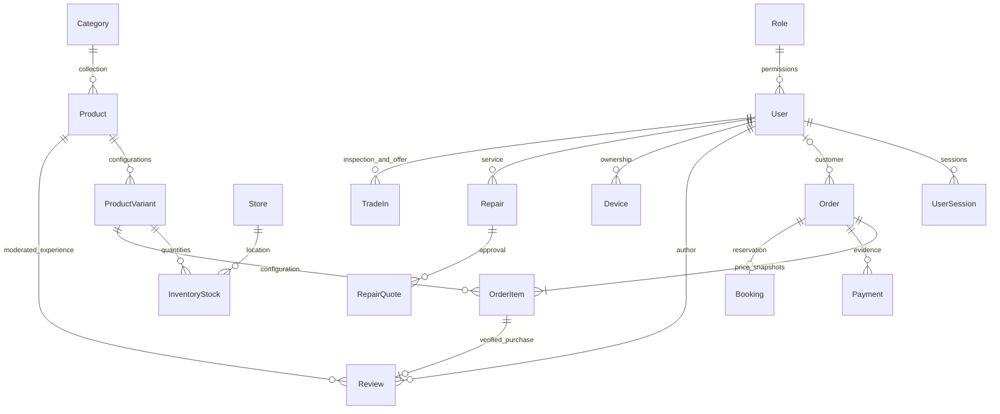

# Database and migrations

PostgreSQL is the relational source of truth. Prisma 6.19 describes **131 models**. The [complete ERD](docs/database-erd.mmd) is generated from the current schema and contains 96 declared foreign-key relations. It includes schema-only future modules; string references in those scaffolds are not additional enforced foreign keys.



## Integrity rules

- Money is stored in integer **paisa**; NPR display divides by 100. Stock is scoped to variant and store. Checkout validates the current price and stock rather than trusting client totals.
- Orders retain historical prices, addresses and policy acceptance. Guest receipt keys and session tokens are hashed. Customer cart/wishlist writes use an account revision to detect conflicting writes.
- Migration-owned SQL checks constrain stock, deposits, quantities, quote totals and review ratings. Partial unique indexes prevent conflicting pending service decisions. Append-only triggers preserve device, QC, parts and money evidence.
- `Review` has unique order-item and customer/product constraints, a rating check of 1–5, and product/user/order-item foreign keys. API eligibility additionally requires the order to belong to the author and be delivered. Only `PUBLISHED` reviews appear publicly.
- Serial identifiers are hashed for uniqueness and shown by their last four characters. Recoverable full IMEI/EID encryption and key management are not implemented.
- Many scaffold models use strings for status or future relationships. Do not bypass operational services or expose generated CRUD as a substitute for integrity rules.

## Migration history

| Migration                                         | Purpose                                                            |
| ------------------------------------------------- | ------------------------------------------------------------------ |
| `20260920072414_foundation`                       | Original catalog, identity, commerce, service and content schema   |
| `20260920095146_allocation_and_policy_acceptance` | Physical allocation and accepted policy snapshots                  |
| `20260920101000_integrity_constraints`            | Financial and stock checks                                         |
| `20260920104000_unique_pending_decisions`         | Unique pending service decisions                                   |
| `20260920161454_sections_91_203`                  | Future Device OS schema; not automatic workflow support            |
| `20260921000100_canonical_device_integrity`       | Canonical identity bridge and device evidence                      |
| `20260921000200_repair_parts_and_quote_versions`  | Parts/QC and versioned trade-in quotations                         |
| `20260921000300_procurement_receiving`            | Purchasing, receiving and location relationships                   |
| `20260921000400_order_money_ledger`               | Immutable order money entries and backfill                         |
| `20260921000500_immutable_service_evidence`       | Database protection of service evidence                            |
| `20260921000600_account_shop_revision`            | Revision-checked customer shopping state                           |
| `20260921000700_repair_technician_assignment`     | Verified staff assignments and retained assignment history         |
| `202609270001_account_recovery`                   | Account status, verification/reset tokens and session invalidation |
| `202609270002_verified_commerce_payments`         | Quote/retry/payment verification persistence                       |
| `20260927000300_retailer_tenants`                 | Retailer applications and scoped memberships                       |
| `202609270004_price_publication`                  | Research sources, currency/configuration and publication controls  |
| `202610060001_verified_reviews`                   | Delivered-purchase reviews, publication state and rating checks    |

The review migration also hides three identified conceptual development fixtures only when their description contains the development seed marker. It preserves all products and historical relationships; it does not alter matching commercial products without that marker. The seed no longer creates those conceptual entries and creates no reviews, orders or revenue.

## Workflow

```sh
pnpm db:generate
pnpm --filter api exec prisma validate
pnpm db:migrate
pnpm db:test:migrate
```

`db:migrate` applies existing reviewed migrations. To author a new one, use Prisma migration development on a disposable development database, review the generated SQL and custom constraints, and commit it alongside generated contract changes. Do not use `db push` or reset a commercial database.

The development seed requires `SEED_DEVELOPMENT=true`, refuses production and preserves existing role permissions. Its product facts, prices, stock, illustrations and store details are explicitly development data. Commercial records require merchant review.

All 17 migrations were applied locally to the development and isolated test databases. A current local recovery snapshot was saved to `/tmp/iphonebooking-v2-20261006.dump` with owner-only file access; it contains private data and must stay outside source control. This snapshot is not an off-site backup or a production restore drill. See [DEPLOYMENT.md](DEPLOYMENT.md) for operational backup requirements.
