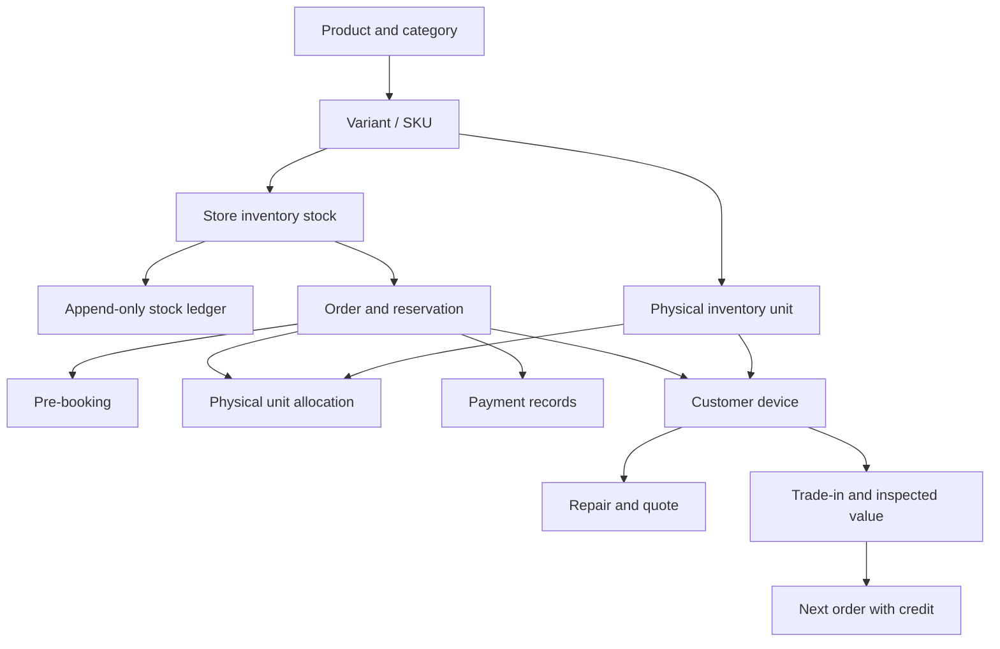

# Architecture

> Historical implementation note. The 6 October 2026 refresh is documented in [ARCHITECTURE.md](../ARCHITECTURE.md), [API.md](../API.md), [DEPLOYMENT.md](../DEPLOYMENT.md) and [TESTING.md](../TESTING.md). Those files supersede older payment/mail, homepage, build-command and verification claims below.

The storefront uses React 19, Vite, strict TypeScript, React Router, TanStack Query for server data, and Zustand for the anonymous bag, wishlist, and comparison selection. Filters live in URL parameters. Account credentials are never placed in browser storage. Styles are split into design tokens, storefront, workflow pages, and operations UI.

Express 5 exposes `/api/v1`. Zod validates mutation bodies, Prisma issues parameterized database queries, and PostgreSQL owns transactional state. Presentation components use the typed API client rather than database calls. Routes are grouped into authentication, catalog, commerce, account, services, admin reads, admin creation, and operations. Money is integer NPR paisa throughout. Browser totals are estimates; the server uses current variant prices.

## Device lifecycle

`OrderItem` records the price and stock location used at reservation. Checkout decrements available stock and increments reserved stock with an atomic condition inside a serializable transaction. Every movement appends a ledger entry. The worker releases unpaid reservations once after 24 hours. Expiration releases an unused trade-in credit and preserves the release in the audit trail.

Store-payment records are created only by a staff account with `payment.collect`. A unique receipt reference prevents recording the same receipt twice. Deposits change the booking into an allocation-ready state; the remaining balance must be paid before handover. Allocation reserves physical units exclusively for the order. Handover assigns the unit to a customer device and connects its purchase and warranty record. Guests first connect the order to their account using the private confirmation key.

Customer repair and trade-in requests can reference a device they own. Repairs without an existing purchase record are also accepted. Customer ownership is checked by the server. Repair status transitions are constrained by a service state machine. Quote decisions update only pending quotes and retain a decision timestamp. A partial unique database index prevents two pending repair quotes.

Trade-in calculations live in `server/services/valuation.ts`, with model prices and condition factors in the database. Only an inspected, accepted valuation is eligible for checkout credit. The unique order/trade-in relationship and transactional checks prevent double spending. Buyback is request intake and inspection, not an implemented payout system.

## Data model

The Prisma schema includes users, roles, sessions, addresses, products, categories, variants, compatibility, stores, inventory stock, stock movements, physical units, carts, wishlists, orders, order items and history, bookings, allocation, payments, refunds, devices, trade-ins and valuation rules, repairs and quotes, tickets and messages, notifications, CMS pages, audit logs, webhook event records, jobs, analytics events, subscribers, and policy acceptance snapshots.

Migrations add database checks for nonnegative stock, valid variant prices and deposits, valid order totals, positive quantities, and correct repair quote totals. Custom SQL indexes and checks are migration-owned. Do not replace migrations with `db push`. After changing schemas, generate a migration and review custom SQL preservation.

Inventory counts are location-specific. The initial physical serial registry is variant-specific; physical unit location transfer, dual IMEI/EID encryption, supplier procurement, and warehouse accounting remain open scope. Serials are irreversibly hashed for uniqueness and only their last four characters are exposed. A controlled encryption/key-management design is required before supporting recoverable full identifiers.

## Authentication and authorization

Passwords use bcrypt. A random opaque session token is stored in an HttpOnly, SameSite=Lax cookie; only its SHA-256 hash is stored in the database. Production cookies are Secure. Sessions expire after seven days and can be revoked. Password changes revoke other sessions. Server-side permission checks apply to every admin handler; hiding navigation is supplementary only.

Mutation requests require an application header and an allowed Origin. Browser CORS is not enabled. Never expose the API through an unrestricted CORS proxy. Helmet adds security headers. Authentication and general API endpoints are rate limited in process; shared rate-limit storage is required before multi-instance deployment. Logs omit request bodies, passwords, tokens, and full identifiers.

## Payments and jobs

`PaymentProvider` defines create, verify, refund, and webhook methods. The only configured implementation is `UnconfiguredProvider`, which fails closed with 503. Provider webhooks cannot mark anything paid. No eSewa, Khalti, card, or bank integration is claimed complete. Store payment is a separate audited human-recorded workflow.

The background worker stores jobs in PostgreSQL, uses conditional claims, retries with backoff, recovers expired processing leases, and marks repeatedly failing jobs dead. Reservation cleanup is the implemented handler. Email, SMS, image processing, import, export, and payment reconciliation handlers still require implementation and provider setup.

## Frontend serving

Production Express injects canonical links, metadata, OpenGraph, and product JSON-LD from the database into the Vite shell. Sitemap generation is database-driven. Account/admin/filter URLs are noindex. This is metadata rendering, not full server rendering of page content. A full prerender/SSR strategy remains needed if crawler-independent product content is a launch requirement.

The PWA service worker caches only the static offline page and icon. Navigation is network-first and sensitive APIs are never cached. Full offline commerce is intentionally unsupported.

## Reference decisions

Transactional isolation follows the [Prisma 6 transaction documentation](https://www.prisma.io/docs/orm/v6/prisma-client/queries/transactions). Async route errors flow through the central handler using [Express 5 error handling](https://expressjs.com/en/guide/error-handling/). Prisma remains pinned to version 6.19; migration commands intentionally match that major version.
